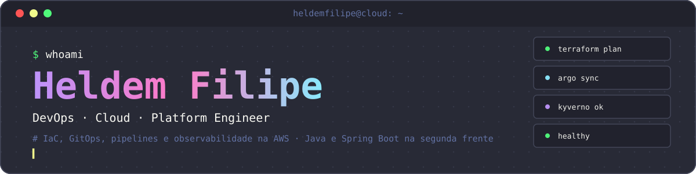

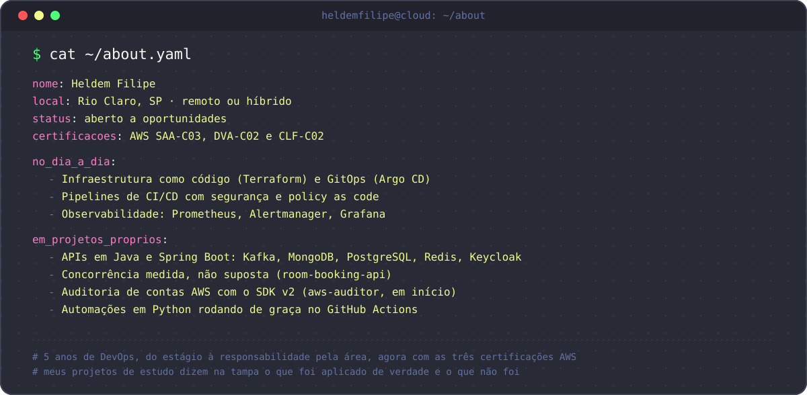

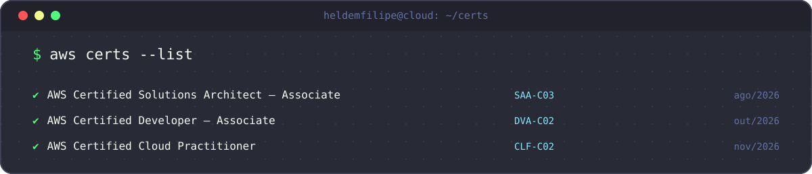

<a href="https://github.com/heldemfilipe/eks-gitops-platform">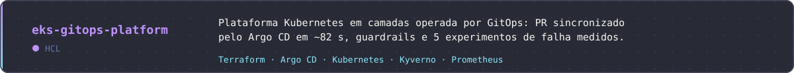</a>

<a href="https://github.com/heldemfilipe/eks-gitops-config">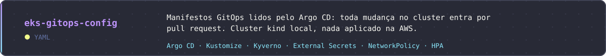</a>

<a href="https://github.com/heldemfilipe/terraform-aws-foundation">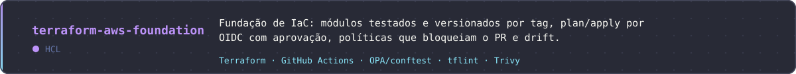</a>

<a href="https://github.com/heldemfilipe/orders-api">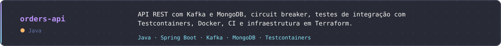</a>

<a href="https://github.com/heldemfilipe/room-booking-api">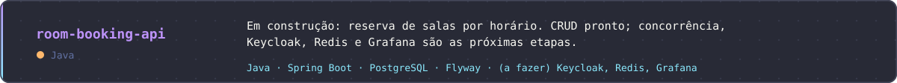</a>

<a href="https://github.com/heldemfilipe/tasks-api">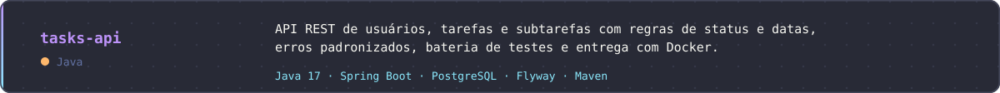</a>

<a href="https://github.com/heldemfilipe/radar-tech">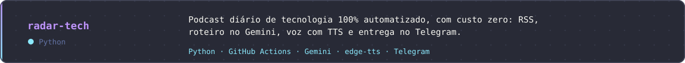</a>

<a href="https://github.com/heldemfilipe/radar-panorama">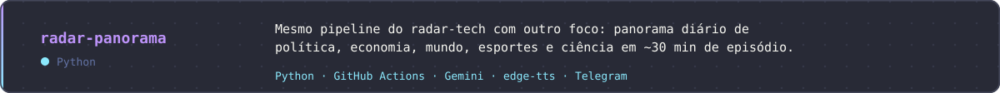</a>

> `terraform-aws-foundation` e `eks-gitops-platform` são projetos de estudo: validados com testes, `plan` offline e políticas, **nunca aplicados na AWS**. No segundo, o cluster que rodou de verdade é um `kind` local. Os READMEs mostram o que foi executado e o que não foi.

<a href="https://github.com/heldemfilipe/controle-financeiro">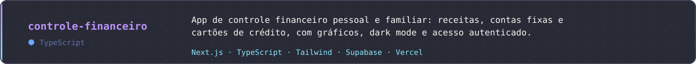</a>

<a href="https://github.com/heldemfilipe/compras_mercado">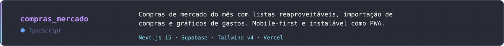</a>

<a href="https://github.com/heldemfilipe/EBD-chamada">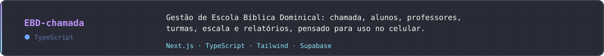</a>

<a href="https://github.com/heldemfilipe/membros-igreja">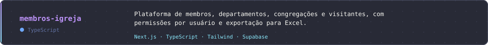</a>

<a href="https://github.com/heldemfilipe/Supabase-Keep-Alive">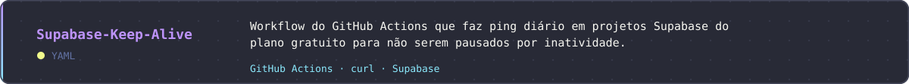</a>

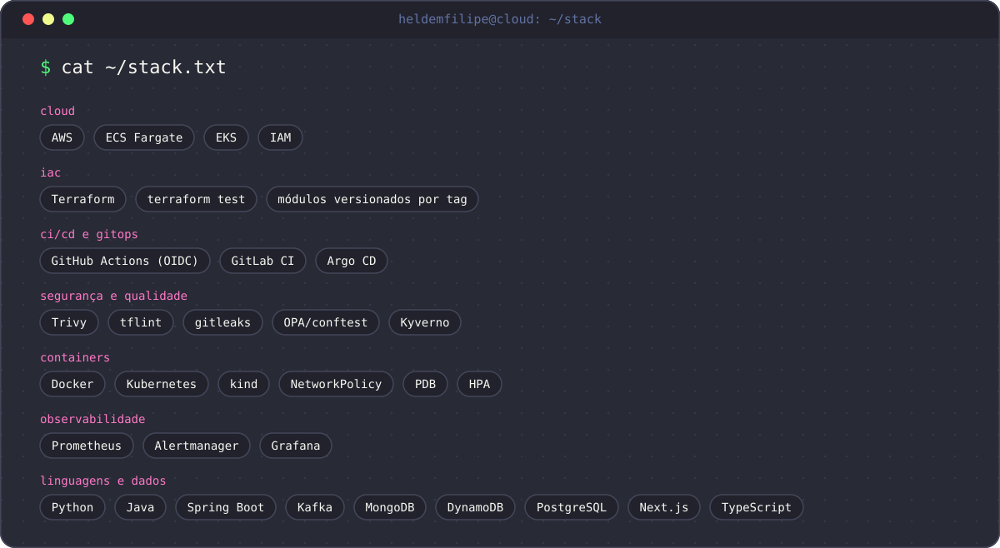

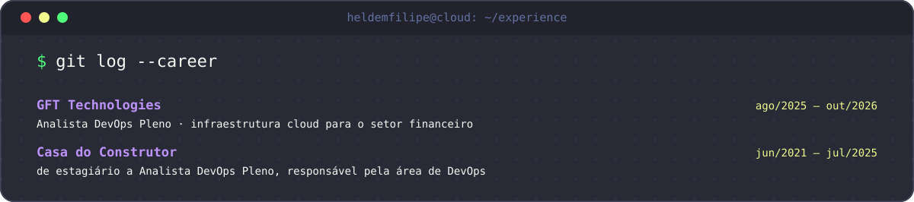

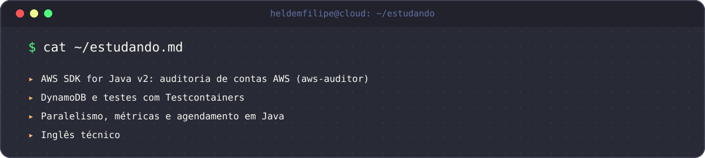

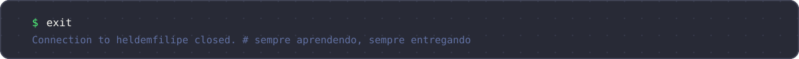
